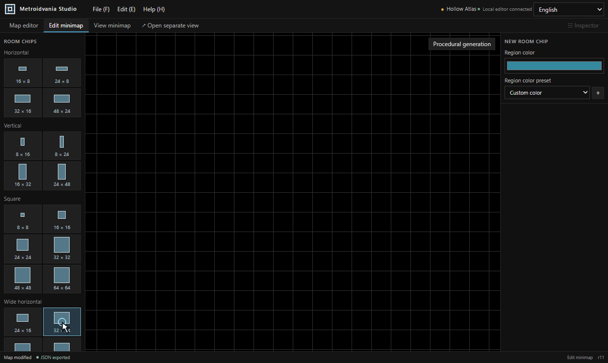
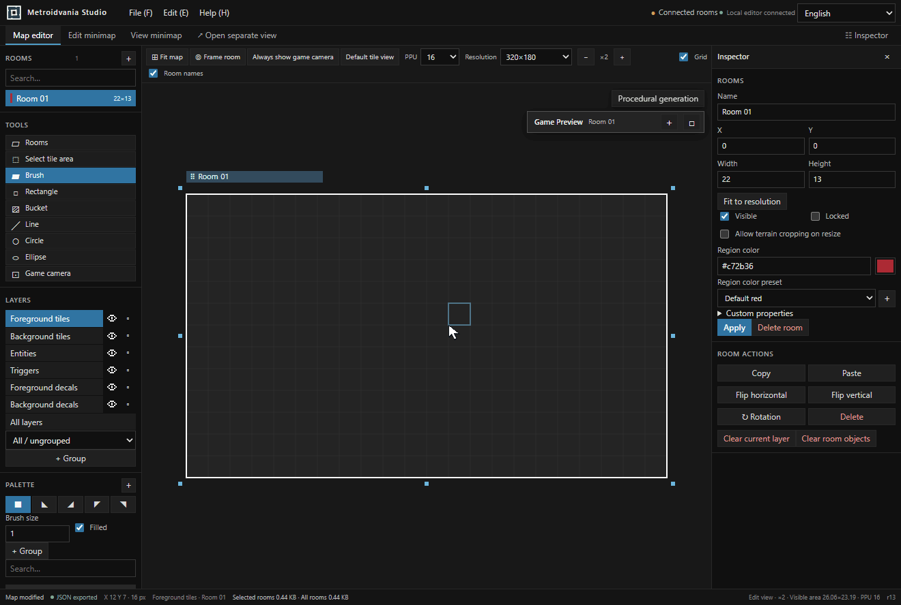
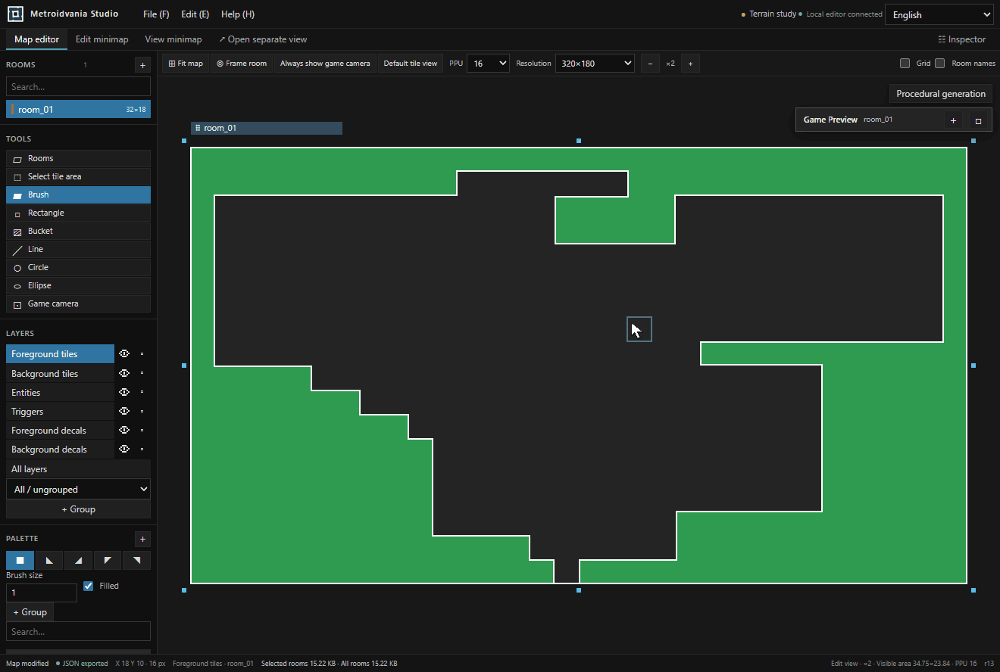
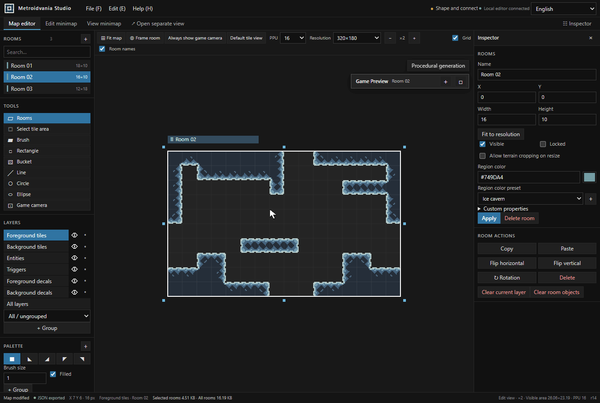
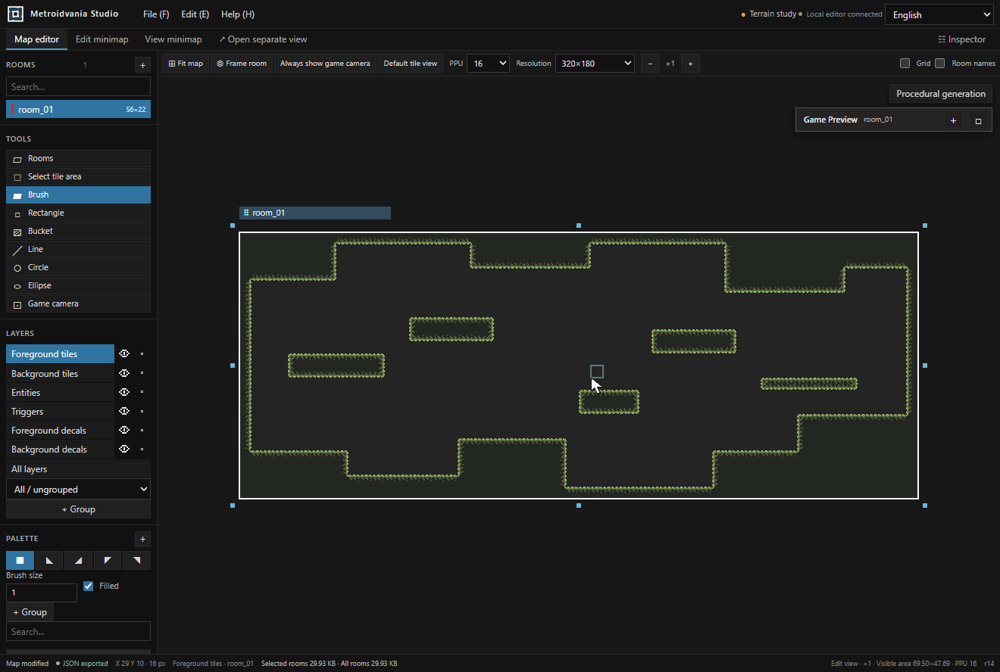

#  Metroidvania Studio

Metroidvania Studio is a free, open-source 2D level editor for metroidvania games. Build connected rooms, paint autotiled maps, and design minimaps with JSON export for multiple game engines. The room-based map editor runs locally in your browser or the Windows program.

[Get started](#get-started) · [Website](https://lbarimi.github.io/metroidvania-studio/) · [Documentation](https://lbarimi.github.io/metroidvania-studio/guides.html) · [Release notes](CHANGELOG.md)

This checkout builds **1.3.3**, with the minimap chip editor and the `minimap.place` command for CLI, MCP and Lua. [Build the editor](#build-from-source) or [install the CLI from source](#scripts--automation). The current public release is **1.3.2** on [GitHub Releases](https://github.com/LBarimi/metroidvania-studio/releases/tag/v1.3.2) and [npm](https://www.npmjs.com/package/metroidvania-studio/v/1.3.2).

**Automate your workflow:** [Lua scripts](docs/scripting/quick-start.md), a [headless CLI](docs/cli/quick-start.md), and a [local MCP server for AI agents](docs/mcp/setup.md).

## Design Your Minimap

Click once per room in **Edit minimap** to join corridors, shafts and chambers. Watch 102 rooms take shape across six colored regions, then switch to **Map editor** to see the same world as empty room outlines. [Minimap editing guide](docs/minimap.md)



Recreate the layout with the headless CLI or MCP by applying the [102-room minimap batch](docs/examples/minimap-world.json). [Run the example](docs/minimap.md#place-chips-with-the-cli-or-mcp)

## Add Rooms & Paint Tiles



## Configure Tile Palettes



## Resize, Rotate & Connect Rooms



## Explore with Game Preview



## Get Started

### Run a release download

Choose a ZIP from [GitHub Releases](https://github.com/LBarimi/metroidvania-studio/releases/latest), extract the entire archive to a writable folder and keep `app/` beside the launcher. The editor runs independently of your game engine.

| Download | Open from the extracted folder | Requirements |
| --- | --- | --- |
| `metroidvania-studio-win.zip` · Windows x64 | `metroidvania-studio.exe` | [Microsoft Edge WebView2 Runtime](https://developer.microsoft.com/en-us/microsoft-edge/webview2/). .NET is included. |
| `metroidvania-studio-mac.zip` · Apple silicon or Intel x64 | `metroidvania-studio.command` | A browser. .NET is included. |
| `metroidvania-studio-linux.zip` · ARM64 or x64 | `bash ./metroidvania-studio.sh` | A browser. .NET is included. |
| `metroidvania-studio-web.zip` · Windows, macOS or Linux | Windows `metroidvania-studio.bat`, macOS `metroidvania-studio.command`, Linux `bash ./metroidvania-studio.sh` | A browser and [ASP.NET Core Runtime 10](https://dotnet.microsoft.com/en-us/download/dotnet/10.0). |

The browser launchers open `http://127.0.0.1:18765/` by default. Run the same browser launcher with `--stop` to save and stop the local server. On Windows, closing the desktop EXE stops the server it started.

### Build from source

Use a Git checkout of the version you want to build and install these tools. The first build downloads dependencies when the local cache is empty.

| Requirement | Used for |
| --- | --- |
| [Node.js 24+](https://nodejs.org/en/download) | Builds the web UI. Check with `node --version`. |
| [.NET SDK 10](https://dotnet.microsoft.com/en-us/download/dotnet/10.0) | Builds the server and CLI. Check for a `10.0.x` SDK with `dotnet --list-sdks`. |
| [Git](https://git-scm.com/downloads) | Validates source files in the checkout. Check with `git --version`. |

Run the scripts for your platform from the repository root.

| Platform | Build | Run | Stop |
| --- | --- | --- | --- |
| Windows | `platform/win/web/build.bat` | `platform/win/web/run.bat` | `platform/win/web/stop.bat` |
| macOS | `platform/mac/build.command` | `platform/mac/run.command` | `platform/mac/stop.command` |
| Linux | `bash platform/linux/build.sh` | `bash platform/linux/run.sh` | `bash platform/linux/stop.sh` |

**Run** builds automatically when the checkout changes, then opens the editor in your browser. On Windows, double-click `platform/win/web/rebuild_run.bat` to stop the session, force a full build and relaunch. If the launcher cannot find an installed tool, set `METROIDVANIA_STUDIO_NODE` or `METROIDVANIA_STUDIO_DOTNET` to its executable path. [Build guide](docs/building.md) · [Build the Windows desktop EXE](platform/win/program/README.md)

### Keep or share your work

By default, your workspace lives beside the release launcher or at the root of the source checkout. Keep `Maps/`, `Textures/`, `.studio/` and any saved Lua scripts in `Scripts/` when updating. Find the active paths under **File → Storage folders**. Individual room exports update in `Maps/AutoExport/` and the palette catalog lives in `.studio/catalog.json`.

To share the current world with its palettes and textures, choose **File → Export project bundle… → Download ZIP**. Open an extracted bundle by passing its folder to the launcher with `--project`. [Project bundle guide](docs/project-bundles.md)

## Try the Sample World

A new workspace opens a six-room world with a looping route, a vertical shaft, a side chamber, slopes, background tiles, and object markers. You can also open it through **Help → Open sample world**.

Paint a room, **Ctrl-click** two rooms to move them together, or extend the upper route in **Edit minimap**. Double-click a room to inspect its bounds in **Map editor**. See the [five-minute walkthrough](docs/sample-world.md) or [sample JSON](samples/maps/starter-world.map.json).

## Editing Basics

- **Paint:** left-drag inside the active room. The first click on another room selects it.
- **Erase:** right-drag inside the active room.
- **Pan and zoom:** middle-drag to pan, mouse wheel to zoom, **Ctrl + wheel** to change brush size. Right-drag on empty space also pans.
- **Arrange rooms:** right-click empty space to add a room, drag a room's title strip to move it, or drag its outer handles to resize. Rotation is available in the inspector.
- Hold **Ctrl** or **Cmd** to select multiple rooms and merge them from **Edit**. The selection tool can also split a rectangle into a new room. [Merge and split rooms](docs/room-restructuring.md)
- Place spawn points, portals, invisible walls and numbered trigger regions on the object and trigger layers. [Objects and triggers](docs/objects-and-triggers.md)
- **Save and exchange maps:** use **File** for saving and JSON import/export. Use **Edit** for Undo/Redo. Set PPU and resolution in the top toolbar (defaults: **16** and **320×180**).
- **Preview:** choose **Game camera** and drag its white frame. **Game Preview** follows immediately; expand, maximize, or collapse it as needed.

See **Help → Shortcuts** for the full control list. The interface follows your browser language and can be changed from the language picker.

Open **Help → Documentation** for searchable guides and the API reference, including offline access.

## Engine Packages

| Engine | Integration target | Package | Installation |
| --- | --- | --- | --- |
| Unity | Unity 6 | [.unitypackage](engine-packages/unity/metroidvania-studio.unitypackage) | [Guide](engine-packages/unity/INSTALL_EN.txt) |
| Godot | Godot 4, tested on 4.7.2 | [Addon ZIP](engine-packages/godot/metroidvania-studio.zip) | [Guide](engine-packages/godot/INSTALL_EN.txt) |
| Unreal Engine 4 | 4.27 and its C++ toolchain, tested on 4.27.2 | [Plugin ZIP](engine-packages/ue4/metroidvania-studio.zip) | [Guide](engine-packages/ue4/INSTALL_EN.txt) |
| Unreal Engine 5 | UE5 and its C++ toolchain, tested on 5.8.2 | [Plugin ZIP](engine-packages/ue5/metroidvania-studio.zip) | [Guide](engine-packages/ue5/INSTALL_EN.txt) |
| SDL3 | SDL 3.4+, CMake 3.24+ and a C++17 compiler | [C++ source ZIP](engine-packages/sdl/metroidvania-studio.zip) | [Guide](engine-packages/sdl/INSTALL_EN.txt) |

Each engine folder includes translated installation guides. Maps use JSON format v2 with 16-pixel tiles. Engine packages import and render the rooms, while gameplay stays in your game project. [Map format](metroidvania-studio/contracts/FORMAT.md) · [Engine validation targets](integrations/VALIDATION.md)

## Scripts & Automation

Use **File → Scripts** to generate rooms or repeat editing tasks. Run the same operations headlessly through the **CLI**, or connect an **AI agent** through the local **MCP server**. Dry runs, atomic updates, and revision checks keep scripted edits reviewable.

The npm CLI and MCP server require **Node.js 24+** and the **.NET 10 runtime**. To install the published version, run `npm install --global metroidvania-studio`.

To use `minimap.place` with **1.3.3**, run these commands from the root of this checkout with npm and the [.NET 10 SDK](#build-from-source).

```sh
npm run pack:local
npm install --global ./builds/npm/metroidvania-studio-1.3.3.tgz
metroidvania-studio version
metroidvania-studio capabilities
```

Program downloads include a CLI launcher. From the extracted folder, run `.\metroidvania-studio-cli.cmd help` in Windows PowerShell or `bash ./metroidvania-studio-cli.sh help` on macOS/Linux. [Headless from a download](docs/cli/release-downloads.md)

`version` reports the program version, automation API version (1) and map format version (2). `capabilities` lists the operations available in that build. Connect MCP with `mcp --workspace <folder>` for saved files or `mcp --url http://127.0.0.1:18765` for the running editor and target `@active`. [API reference](docs/api/index.md) · [Lua examples](docs/examples/connected-rooms.lua) · [MCP setup](docs/mcp/setup.md)

## License

Project-owned code and assets use the [MIT License](LICENSE).
See [Third-party notices](THIRD-PARTY-NOTICES.md) for external components and their terms.
