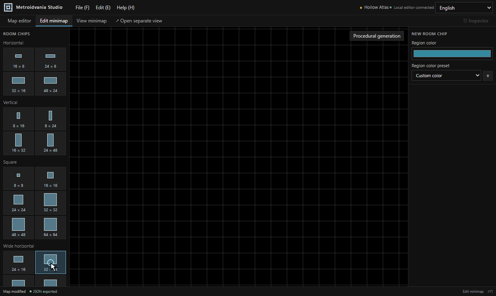

# Minimap design

Each chip in **Edit minimap** places one room. You can lay out an entire world here, then switch to **Map editor** to see its room boundaries. Positions, dimensions and region colors carry across both tabs.

## Place a route and see its outline

1. Open **Edit minimap**. Pick a chip from the left palette. Its label gives the width and height in map tiles.
2. Under **New room chip**, choose a region color. Move the pointer over the grid to preview the outline, then click once per room. Place the next chip against a wall to open a passage. A corner contact leaves both walls closed.
3. Mix horizontal corridors, vertical shafts and square chambers. Change the region color when the route branches into a new area. **View minimap** frames the whole layout so you can trace the connections.
4. Double-click a room in either minimap tab to open it in **Map editor**, or switch directly from **Edit minimap** to **Map editor** to focus the selected room. Click **Fit map** to see every room at once. For a clean outline view, turn off **Grid** and **Room names**. A newly placed room has empty foreground and background tile layers.



## Generate a minimap

In **Edit minimap**, click **Procedural generation** in the upper-right corner of the grid. Choose **Save and continue** to keep the current map, or **Continue without saving** to go straight to the settings. You can cancel the settings and keep editing the current layout.

Enter a **Room count** from 1 to 1,024 and click **Generate minimap**. By default, the generator uses the full chip palette and assigns region colors automatically. To make a world of narrow shafts, choose **Use only selected chips** and pick vertical sizes. To keep everything except a few shapes, choose **Exclude selected chips**. Under **Region color**, choose **Choose from presets** to set the colors yourself. Each chosen color forms a connected region.

**Random seed** is checked by default. Clear it to enter a numeric **Seed**. The same seed, room count, chips and color settings reproduce the same layout and regions. The map stores its seed, so clearing **Random seed** the next time you open the dialog recalls it.

In **Edit minimap**, watch the rooms appear in placement order over one second. Routes branch with open space between them. Where a chip can bridge two rooms that are at least five passages apart, the generator can reconnect them with a two-passage shortcut, including across region colors. Switch to **Map editor** to see the whole layout as empty room outlines, or double-click a room to work on it.

## Adjust a room

Choose from 34 chip sizes, including squares, wide rooms and long shafts. The grid uses smaller subdivisions when an existing room needs them. In Starter World, the 14-tile-wide Lift Shaft and the 18-tile-high Landing fit the two-tile grid.

Drag a room to move it. A red dashed preview marks an overlap, and releasing there keeps the original layout. Right-click an unlocked room to delete it immediately. **Ctrl+Z** restores the room and its contents. To change its dimensions, open it in **Map editor** and use the inspector. [Room layout](room-layout.md)

## Place chips with the CLI or MCP

The [102-room batch from the demo](examples/minimap-world.json) rebuilds all six regions on an empty map. It requires the `minimap.place` operation introduced in 1.3.3. Build the CLI using the [source instructions](cli/quick-start.md). From the repository root, the following PowerShell commands use that local build to create a separate demo workspace.

```powershell
$cli = "./metroidvania-studio/cli/bin/Release/net10.0/MetroidvaniaStudio.Cli.dll"
$workspace = "./.local/minimap-demo"
New-Item -ItemType Directory -Force $workspace | Out-Null
Copy-Item ./docs/examples/minimap-world.json $workspace
dotnet $cli init --workspace $workspace --map world.map.json
dotnet $cli apply --workspace $workspace --map world.map.json --batch minimap-world.json
dotnet $cli preview --workspace $workspace --map world.map.json --output world.svg
```

To place chips in the open editor, start the editor and [MCP server](mcp/setup.md) from the 1.3.3 release ZIP or source build and connect using the editor URL. Check that `studio_capabilities` lists `minimap.place`. Call `studio_inspect` with `map: "@active"`, then pass its `revision` as `expectedRevision` to `studio_apply`. Set `batch` to the contents of the example or to a batch of your own. Each `minimap.place` creates one room. **Ctrl+Z** in the editor undoes the whole batch. [MCP call example](mcp/tools.md)

## Room colors

The color under **New room chip** applies to the next rooms you place. To recolor an existing room, select it and use the color control beneath its name. Choose a project palette color from **Region color preset**, or pick a color and use **+** to save a named preset in this browser. The **Map editor** inspector offers the same presets.

## Navigate and edit

Middle-drag to pan and use the wheel to zoom. In **View minimap**, use **Fit map**, **Frame room** or the room names toggle to find a room in a large layout.

## Outlines and entrances

**View minimap** has separate **Outline** and **Entrance length** controls. Their defaults are **9** and **15**. Both scale with zoom. Unselected room interiors dim so the white walls and entrances remain easy to follow. To change which rooms meet, move a room in **Edit minimap**.

## Try a complete world

The [sample world walkthrough](sample-world.md) follows the route through Landing, Canopy, Lift Shaft, Sky Bridge and Lookout before you extend it.
