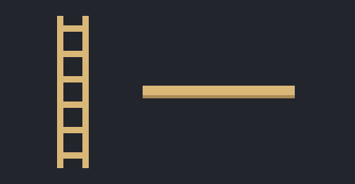

# Traversal chips

Both PNGs use a transparent 16×16 canvas. Repeat `ladder.png` vertically and `floor.png` horizontally. The ladder uses one sand color. The floor uses the same color and one darker pixel row along its lower edge. Its walkable surface aligns with the top of the tile.

The source shapes were generated with Codex ImageGen and reduced to the editor's pixel grid. Both chips appear in the **Traversal** tile palette.
